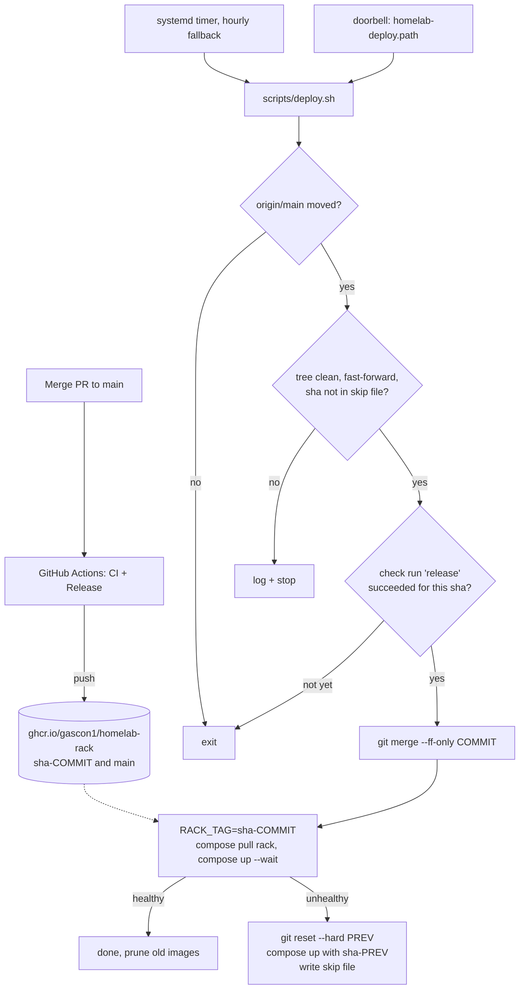

# Automatic deploys (pull-based, with a push doorbell)

When `main` has a new commit and its `release` check is green, the server fast-forwards the repo, pulls the new Rack image and restarts the stack. If the stack does not become healthy, it rolls back by itself.

The server decides by itself and always asks GitHub. Two things start a check: a push "doorbell" from the `Release` workflow (a few seconds after the release job is green), and an hourly timer as a fallback. See [Push trigger (doorbell)](#push-trigger-doorbell).

Setup steps are in [Part D of MANUAL-STEPS](remote-access/MANUAL-STEPS.md#part-d-automatic-deploys).

## How it works



Details:

- `scripts/deploy.sh` takes a lock (`.deploy-state/deploy.lock`), so a manual run and the timer never overlap.
- The gate calls `GET /repos/Gascon1/homelab/commits/<sha>/check-runs?check_name=release`. It uses only check runs made by GitHub Actions (`app.slug == "github-actions"`), takes the newest one, and passes only on `conclusion == success`. The script then merges that exact sha, not `origin/main`, so a `git fetch` in parallel cannot slip in an unchecked commit.
- Pulls: only the `rack` image (`docker compose pull rack`), plus every image when a `compose*.yml` file changed in the deploy. Set `PULL_ALL=1` to pull every image on each deploy. After the pull, the script checks that `ghcr.io/gascon1/homelab-rack:sha-<commit>` is present. If it is not, it reverts and tries again on the next run (compose only warns when a pull of a service with `build:` fails, and `up` would then build it on the server).
- Profiles: docker compose reads `COMPOSE_PROFILES` from `.env`. If you use remote access, set `COMPOSE_PROFILES=remote` (or `remote,push` with the doorbell) in `.env` (not only `--profile remote` on the command line), so deploys also update `tailscale` and `caddy`. Each deploy logs the profiles it uses. Without the profile, `--remove-orphans` does not remove them, but deploys do not update them.
- Each log line has a UTC timestamp and the short commit sha.
- `.env` and `appdata/` are never touched. `.env` is gitignored.
- Options: `--dry-run` (print the plan), `--force` (skip the gate and the skip file), `--help`.
- Config is read from `/etc/homelab-deploy.env`, else `deploy/deploy.env` (gitignored; see `deploy/deploy.env.example`). The file is parsed, not sourced.
- After a good deploy, unused rack images older than 7 days are pruned (`PRUNE=1`, set `PRUNE=0` to keep all). This needs the image label `org.opencontainers.image.source`, which the release workflow sets.

## Push trigger (doorbell)

The hourly timer is slow. The doorbell makes a deploy start within a minute, and the server still connects to nobody.

```mermaid
flowchart LR
    R[release job green] --> N[notify job]
    N -->|OAuth, tag:ci| TS[ephemeral tailnet node]
    TS -->|POST /deploy, HMAC<br/>tailnet only, port 9000| C[Caddy, remote profile]
    C --> H[deploy-hook container, push profile]
    H -->|verify HMAC + time,<br/>write trigger file| TF[(appdata/deploy-hook/trigger)]
    TF -->|PathModified| P[homelab-deploy.path]
    P --> SV[homelab-deploy.service]
    SV --> D[scripts/deploy.sh]
    D -->|asks GitHub: release check<br/>green for this exact sha?| GH[(GitHub API)]
```



The request is `POST /deploy` with body `{"sha":"<40 hex>","ts":<unix seconds>}` and header `X-Signature-256: sha256=<HMAC-SHA256 of the body>`. The receiver (`deploy-hook/hook.py`) answers 401 for a bad signature or a `ts` more than 300 s away, 413 above 1 KiB, 400 for a bad sha, 404/405 for other paths and methods. On success it answers 202 and writes `<sha> <ts>` to the trigger file (atomic rename). Requests less than 10 s apart do not rewrite the file. `homelab-deploy.path` watches that file and starts `homelab-deploy.service`, the same unit the timer starts.

### Why the trigger carries no authority

The doorbell only says "look now". `deploy.sh` ignores the sha in the trigger file. It runs the same steps as a timer run: fetch `origin/main`, ask the GitHub API whether the `release` check (from the `github-actions` app) succeeded for that exact commit, merge only that sha, and roll back if the stack is unhealthy. If the secret leaks, an attacker can make the server check GitHub earlier. They cannot make it deploy anything that is not a green commit on `main`. A lost or failed doorbell costs at most the time until the next hourly run.

If a trigger arrives while a deploy runs, `deploy.sh` checks the trigger file again after the run, so the new commit is not lost.

### Why there is no self-hosted runner

The repo is public. A self-hosted runner on a public repo runs workflow code from fork pull requests on your server. A runner is also a standing connection with a token. The doorbell has no runner: GitHub's own runners join the tailnet for a few seconds as an ephemeral node, tagged `tag:ci`. The tailnet policy lets `tag:ci` reach only `tag:homelab` on TCP 9000. Caddy forwards that port to the one container that does nothing but check an HMAC.

### Secrets and variables

Set these in GitHub, Settings > Secrets and variables > Actions:

| Name | Kind | Value |
| --- | --- | --- |
| `DEPLOY_HOOK_SECRET` | repository secret | `openssl rand -hex 32`. The same value is `DEPLOY_HOOK_SECRET` in the server `.env` |
| `TS_OAUTH_CLIENT_ID` | repository secret | Tailscale OAuth client ID |
| `TS_OAUTH_SECRET` | repository secret | Tailscale OAuth client secret |
| `TS_HOST` | repository variable | `homelab.<YOUR-TAILNET>` (the `TS_HOSTNAME` and `TS_TAILNET` values joined) |

Tailscale side:

- Paste the updated `docs/remote-access/tailscale-policy.example.hujson`. It adds `tag:ci` (owned by `autogroup:admin`) and one grant: `tag:ci` to `tag:homelab` on `tcp:9000` only. Its tests check that `tag:ci` cannot reach ports 4000, 443, 8080, 19999 or 22, and that family cannot reach 9000.
- Make an OAuth client (Tailscale admin console, Settings > OAuth clients) with **one scope: `auth_keys`, write** (in the console: Keys > Auth Keys > Write), and the tag `tag:ci` on that scope. The action's README and `tags` input at the pinned commit require exactly this scope, and that the client's tags match the `tags` input. Do not use `devices:core`: that scope can also delete and authorize every device on the tailnet. Select no other scope. Every node the action makes has only `tag:ci`.
- The workflow uses [`tailscale/github-action`](https://github.com/tailscale/github-action) v4.4.0, pinned by commit SHA `064b10558093f38325e838ddea35486bdc6b1d5c`. Inputs used: `oauth-client-id`, `oauth-secret`, `tags`. With an OAuth client the action joins as an ephemeral, preauthorized node and logs out in its post step, so Tailscale removes the node when the job ends.

Server side:

- The `deploy-hook` container is in its own compose profile, `push`. Set `DEPLOY_HOOK_SECRET` in `.env` first, then set `COMPOSE_PROFILES=remote,push`. The hook refuses to start without a secret of at least 32 characters, and with the profile on, `docker compose up --wait` (each deploy) would then fail and roll back. That is why the hook is not in the `remote` profile.
- Without the `push` profile, Caddy's `:9000` site answers 502. Caddy looks up `deploy-hook` per request, so the other sites keep working.

### The hourly timer fallback

`homelab-deploy.timer` now runs every hour (it was every 3 minutes). It covers a missed doorbell, a server that was off, a fork or repo without the secrets, and a `release` check that was not green yet when the doorbell rang. Change `OnUnitActiveSec` in the unit file (then run `./deploy/install.sh` again) if you want another interval.

### Turn push deploy off

Delete the repository secrets `DEPLOY_HOOK_SECRET`, `TS_OAUTH_CLIENT_ID` and `TS_OAUTH_SECRET`. The `notify` job then prints "push deploy not configured; the timer fallback will deploy" and passes. For a full shutdown also revoke the OAuth client in Tailscale, remove `push` from `COMPOSE_PROFILES` in `.env`, run `docker compose --profile push rm -sf deploy-hook`, and run `sudo systemctl disable --now homelab-deploy.path` on the server. Deploys continue every hour.

### Troubleshooting

- **No deploy after a merge.** Open the `notify` job in the Actions run. "push deploy not configured" means a secret or `TS_HOST` is missing. A `curl` error means the tailnet join or the receiver failed: 401 is a wrong secret or a clock more than 300 s off, a connection error is a policy or Caddy problem.
- **The receiver.** `docker logs deploy-hook` shows one line per request (status, no secrets; healthchecks are not logged). No line means the request never arrived. A 502 in the `notify` log means Caddy has no `deploy-hook` to forward to: add the `push` profile.
- **The path unit.** `systemctl status homelab-deploy.path` must say `active (waiting)`. If it is missing, run `./deploy/install.sh` again. After a trigger, `journalctl -u homelab-deploy -n 50` shows the run.
- **A run says "gate pending".** The `release` check was not green yet. The hourly timer deploys later, or re-run the failed `notify` job.
- **`notify` is red.** A red `notify` does not change the `release` check, so the deploy gate is not affected.

## Security model

- **Why pull-based.** The repo is public. A self-hosted runner would run code from fork pull requests on your server. An SSH or Tailscale connection from GitHub would put a key to your house on GitHub. With pull, GitHub never gets a login to the server. The server makes outbound HTTPS requests. The optional doorbell (above) only lets a tagged CI node send a signed "check now" message to one port.
- **Why the repo being public matters.** The release check and the image can be read with no secret on the server. There is no token to steal. The cost is that anything in the repo is world-readable, so never commit secrets (`.env` is gitignored).
- **Why `main` must be protected.** The server runs whatever is on `main` (compose files and scripts run with docker group rights, which equal root). Whoever can write to `main` controls the server. Require pull requests and the `CI` checks (`compose`, `shell`, `hook`, `rack`, `image`), block force pushes, and use 2FA on the GitHub account (Task 24).
- **The gate** stops a commit whose tests or image build failed. It is not a review: it does not stop a bad but green change. Do not make `release` a required check: it runs only after the merge, so a pull request would wait for it forever.
- **The service** runs as your user (docker group) with systemd hardening: `NoNewPrivileges`, `ProtectSystem=strict` (only the repo is writable), `PrivateTmp`, no extra capabilities. Docker group access is still root-equivalent, so the hardening limits the script, not Docker.

## Public vs private repo

| | Public (default) | Private |
| --- | --- | --- |
| Release check | No token needed (60 requests/h limit; the hourly timer and the doorbell stay under it) | Set `GITHUB_TOKEN` in `deploy.env`: fine-grained, read-only Checks + Contents + Metadata on this repo only. Without it the script logs `repo private? set GITHUB_TOKEN ...` |
| `git fetch` | HTTPS, no login | Use a read-only deploy key: repo Settings > Deploy keys, leave "Allow write access" unchecked. Set the remote to `git@github.com:Gascon1/homelab.git` |
| Rack image | Package set to Public, pulled with no login | Set `RACK_SOURCE=build` in `deploy.env`. The server runs `docker compose build rack` and tags it `sha-<commit>`. No registry token is needed. When a compose file changed, other services are pulled with `docker compose pull --ignore-buildable` |

Steps for a private repo are Task 37 in MANUAL-STEPS.

## Rollback

- **Automatic.** If `docker compose up --wait` fails, the script runs `git reset --hard <previous>` (safe because the tree was clean), starts the previous image (`sha-<previous>`, or `main` if that image is gone), logs `ROLLBACK`, exits 1, and writes the bad sha to `.deploy-state/skip-sha`. That sha is not retried. A new commit on `main` clears the skip. `--force` ignores it.
- **If the pull fails** (network), or the `sha-<commit>` image is not there after the pull, the script reverts the checkout and retries on the next run. It does not write the skip file.
- **By hand.** Pause the timer and the path unit, then:

```bash
git reset --hard <good-sha>
RACK_TAG=sha-<good-sha> docker compose up -d --wait
```

Fix `main` before you start the timer again, or it deploys `main` again.

## Logs and control

```bash
journalctl -u homelab-deploy -n 50          # recent runs
journalctl -u homelab-deploy -f             # follow
systemctl list-timers homelab-deploy.timer  # next fallback run
sudo systemctl stop homelab-deploy.timer homelab-deploy.path    # pause (timer and doorbell)
sudo systemctl start homelab-deploy.timer homelab-deploy.path   # resume
./scripts/deploy.sh --dry-run               # show the plan
```

Remove everything with `./deploy/install.sh --uninstall`.

## Limits

- **Other apps on `:latest`** (Plex, Sonarr, Radarr and so on) only update when `docker compose pull` runs for them. A deploy pulls them only when a compose file changed (or with `PULL_ALL=1`). Otherwise update them on purpose (MANUAL-STEPS Task 22).
- **Only the Rack image is health-gated and rolled back.** Other apps that update during a full pull are not restored by a rollback.
- **Single architecture.** The release workflow builds `linux/amd64` only.
- **Delay.** With push deploy set up, the deploy starts within a minute after the `release` job turns green. Without it, the deploy waits for the hourly timer (up to 1 hour).
- **Tests.** `scripts/test-deploy.sh` runs deploy.sh against stub `docker` and `curl` and a temporary git origin.
