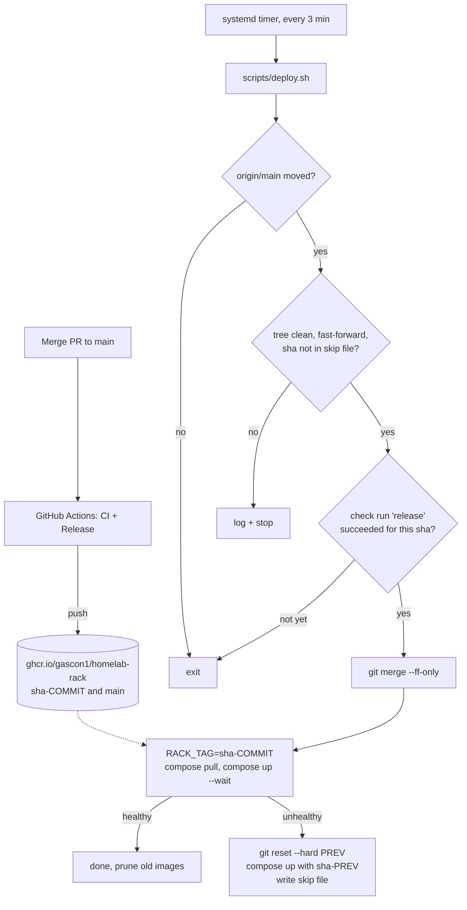

# Automatic deploys (pull-based)

The server checks GitHub every few minutes. When `main` has a new commit and its `release` check is green, the server fast-forwards the repo, pulls the new Rack image and restarts the stack. If the stack does not become healthy, it rolls back by itself.

Setup steps are in [Part D of MANUAL-STEPS](remote-access/MANUAL-STEPS.md#part-d-automatic-deploys).

## How it works



Details:

- `scripts/deploy.sh` takes a lock (`.deploy-state/deploy.lock`), so a manual run and the timer never overlap.
- The gate calls `GET /repos/Gascon1/homelab/commits/<sha>/check-runs?check_name=release`. Only `conclusion == success` passes.
- Each log line has a UTC timestamp and the short commit sha.
- `.env` and `appdata/` are never touched. `.env` is gitignored.
- Options: `--dry-run` (print the plan), `--force` (skip the gate and the skip file), `--help`.
- Config is read from `/etc/homelab-deploy.env`, else `deploy/deploy.env` (gitignored; see `deploy/deploy.env.example`). The file is parsed, not sourced.
- After a good deploy, unused rack images older than 7 days are pruned (`PRUNE=1`, set `PRUNE=0` to keep all). This needs the image label `org.opencontainers.image.source`, which the release workflow sets.

## Security model

- **Why pull-based.** The repo is public. A self-hosted runner would run code from fork pull requests on your server. An SSH or Tailscale connection from GitHub would put a key to your house on GitHub. With pull, nothing connects in. The server only makes outbound HTTPS requests.
- **Why the repo being public matters.** The release check and the image can be read with no secret on the server. There is no token to steal. The cost is that anything in the repo is world-readable, so never commit secrets (`.env` is gitignored).
- **Why `main` must be protected.** The server runs whatever is on `main` (compose files and scripts run with docker group rights, which equal root). Whoever can write to `main` controls the server. Require pull requests and the `CI` and `release` checks, block force pushes, and use 2FA on the GitHub account (Task 24).
- **The gate** stops a commit whose tests or image build failed. It is not a review: it does not stop a bad but green change.
- **The service** runs as your user (docker group) with systemd hardening: `NoNewPrivileges`, `ProtectSystem=strict` (only the repo is writable), `PrivateTmp`, no extra capabilities. Docker group access is still root-equivalent, so the hardening limits the script, not Docker.

## Public vs private repo

| | Public (default) | Private |
| --- | --- | --- |
| Release check | No token needed (60 requests/h limit; polling every 3 min stays under it) | Set `GITHUB_TOKEN` in `deploy.env`: fine-grained, read-only Checks + Contents + Metadata on this repo only. Without it the script logs `repo private? set GITHUB_TOKEN ...` |
| `git fetch` | HTTPS, no login | Use a read-only deploy key: repo Settings > Deploy keys, leave "Allow write access" unchecked. Set the remote to `git@github.com:Gascon1/homelab.git` |
| Rack image | Package set to Public, pulled with no login | Set `RACK_SOURCE=build` in `deploy.env`. The server runs `docker compose build rack` and tags it `sha-<commit>`. No registry token is needed. Other services are pulled with `docker compose pull --ignore-buildable` |

Steps for a private repo are Task 32 in MANUAL-STEPS.

## Rollback

- **Automatic.** If `docker compose up --wait` fails, the script runs `git reset --hard <previous>` (safe because the tree was clean), starts the previous image (`sha-<previous>`, or `main` if that image is gone), logs `ROLLBACK`, exits 1, and writes the bad sha to `.deploy-state/skip-sha`. That sha is not retried. A new commit on `main` clears the skip. `--force` ignores it.
- **If the pull fails** (network), the script reverts the checkout and retries on the next run. It does not write the skip file.
- **By hand.** Pause the timer, then:

```bash
git reset --hard <good-sha>
RACK_TAG=sha-<good-sha> docker compose up -d --wait
```

Fix `main` before you start the timer again, or it deploys `main` again.

## Logs and control

```bash
journalctl -u homelab-deploy -n 50          # recent runs
journalctl -u homelab-deploy -f             # follow
systemctl list-timers homelab-deploy.timer  # next run
sudo systemctl stop homelab-deploy.timer    # pause
sudo systemctl start homelab-deploy.timer   # resume
./scripts/deploy.sh --dry-run               # show the plan
```

Remove everything with `./deploy/install.sh --uninstall`.

## Limits

- **Other apps on `:latest`** (Plex, Sonarr, Radarr and so on) only update when `docker compose pull` runs. The deploy runs `pull` on every deploy, so they update when you merge something, and not otherwise. A deploy can therefore also update those apps. Pin tags in `compose.yml` if you do not want that.
- **Only the Rack image is health-gated and rolled back.** Other apps that update during `pull` are not restored by a rollback.
- **Single architecture.** The release workflow builds `linux/amd64` only.
- **Minimum delay.** The deploy happens 3 to 4 minutes after the `release` job turns green.
- **Tests.** `scripts/test-deploy.sh` runs deploy.sh against stub `docker` and `curl` and a temporary git origin.
